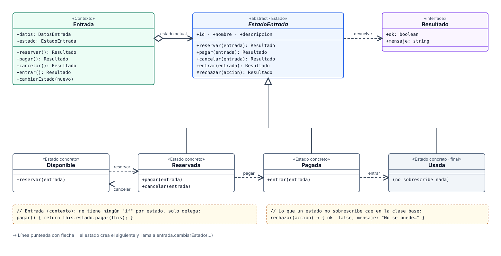
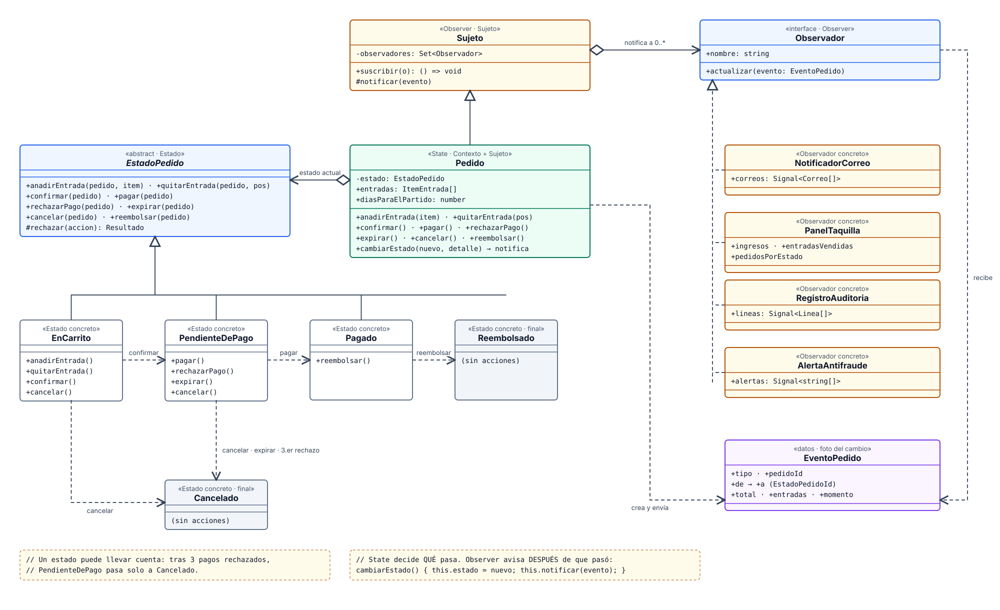

# Patrón State · Venta de entradas del Estadio Metropolitano

Aplicación Angular (solo frontend) con dos ejemplos del patrón de comportamiento
[State](https://refactoring.guru/es/design-patterns/state), ambientados en la web de venta de entradas del
derbi **Real Madrid vs Atlético de Madrid** en el Estadio Metropolitano.

> Sitio no oficial y sin relación con los clubes ni con el estadio. El partido, los precios y los
> asientos son ficticios y no se realizan compras ni cobros. Los escudos se cargan desde Wikimedia (no se
> guardan en el proyecto); las marcas pertenecen a sus propietarios.

## Ramas

| Rama        | Contenido                                                                 |
| ----------- | ------------------------------------------------------------------------- |
| `main`      | Rama desplegada. Muestra el patrón **State**                              |
| `state`     | Código nuevo: los dos ejemplos de State                                   |
| `flyweight` | Copia del trabajo anterior (Flyweight y Bridge), tal como estaba en `main` |

## Los dos ejemplos

La barra amarilla superior de la demo cambia entre ellos.

| Ejemplo | Ruta | Patrones | Qué muestra |
| --- | --- | --- | --- |
| **1 · La entrada** | `/patronState/simple` | State | Una entrada pasa de *Disponible* a *Reservada*, *Pagada* y *Usada*. Cada estado es una clase y acepta solo las acciones que tienen sentido. |
| **2 · El pedido** | `/patronState/observer` | State + [Observer](https://refactoring.guru/es/design-patterns/observer) | Un pedido con 5 estados y reglas propias (máx. 4 entradas, 3 pagos rechazados, reembolso con 7 días o más). Cada cambio avisa a 4 observadores que se pueden suscribir y dar de baja. |

### Ejemplo 1 · Solo State ([`src/app/state-simple/`](src/app/state-simple/))

| Parte del patrón  | Clase                                                                                              |
| ----------------- | -------------------------------------------------------------------------------------------------- |
| Contexto          | [`Entrada`](src/app/state-simple/entrada.ts): guarda el estado y delega las acciones, sin ningún `if` |
| Estado            | [`EstadoEntrada`](src/app/state-simple/estados/estado-entrada.ts): una operación por acción; por defecto rechaza |
| Estados concretos | [`Disponible`](src/app/state-simple/estados/disponible.ts), [`Reservada`](src/app/state-simple/estados/reservada.ts), [`Pagada`](src/app/state-simple/estados/pagada.ts), [`Usada`](src/app/state-simple/estados/usada.ts) |

### Ejemplo 2 · State + Observer ([`src/app/state-observer/`](src/app/state-observer/))

| Parte                | Clase                                                                                                           |
| -------------------- | --------------------------------------------------------------------------------------------------------------- |
| Contexto y sujeto    | [`Pedido`](src/app/state-observer/pedido.ts): delega en su estado (State) y notifica a sus suscriptores (Observer) |
| Estados              | `EnCarrito`, `PendienteDePago`, `Pagado`, `Cancelado`, `Reembolsado` en [`estados/`](src/app/state-observer/estados/) |
| Sujeto / Observador  | [`observador.ts`](src/app/state-observer/observador.ts): `Sujeto`, `Observador` y `EventoPedido`               |
| Observadores         | [`NotificadorCorreo`](src/app/state-observer/observadores/notificador-correo.ts), [`PanelTaquilla`](src/app/state-observer/observadores/panel-taquilla.ts), [`RegistroAuditoria`](src/app/state-observer/observadores/registro-auditoria.ts), [`AlertaAntifraude`](src/app/state-observer/observadores/alerta-antifraude.ts) |

State decide **qué** pasa y a qué estado se va; Observer solo se entera **después** de que ocurrió.

## Diagramas de clases

Están en [`docs/`](docs/README.md), en SVG (vectorial, se amplía sin perder nitidez) y PNG de alta
resolución. En GitHub, haz clic en la imagen para verla en grande.

[](docs/diagramas/01-ejemplo1-clases.svg)

[](docs/diagramas/03-ejemplo2-clases.svg)

## Tecnologías

Angular 19 (componentes standalone, signals y rutas con carga diferida) y Tailwind CSS 4.

## Comandos

```bash
npm install
npm start        # http://localhost:4200
npm test         # pruebas unitarias (Karma + Jasmine)
npm run build    # build de producción en dist/
npx ng deploy --base-href=/patronFlyweight/   # publica en GitHub Pages (rama gh-pages)
```
