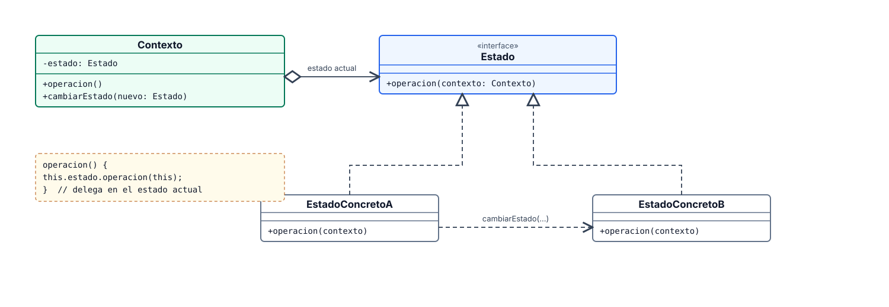
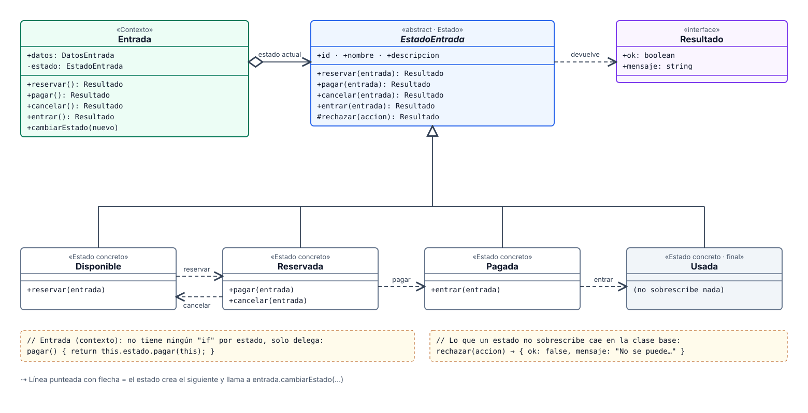
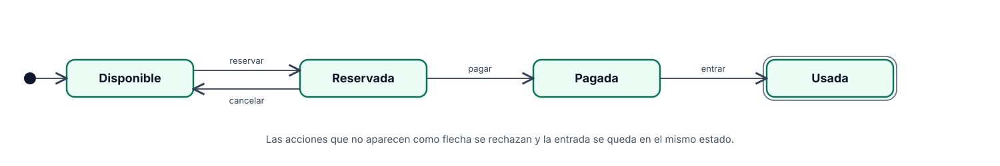
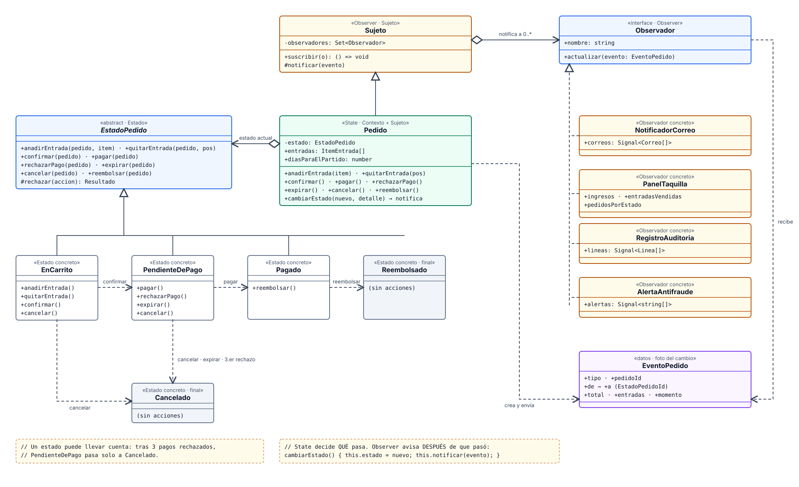
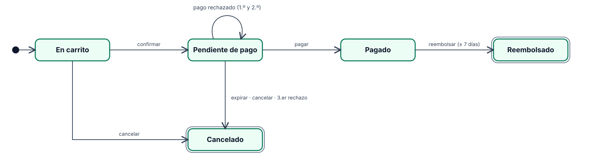
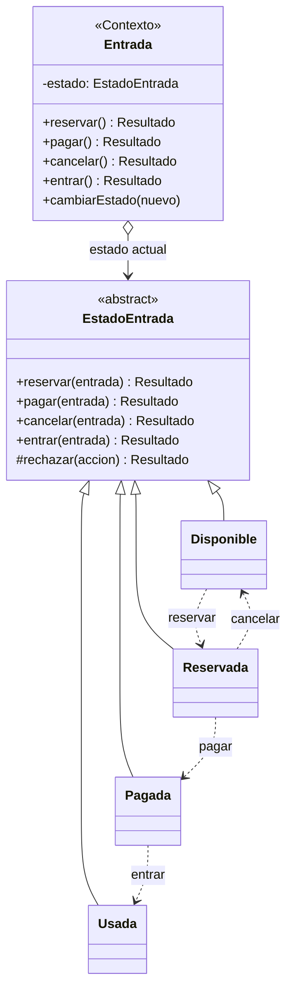
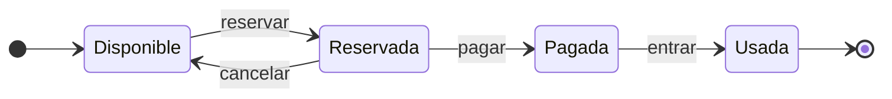
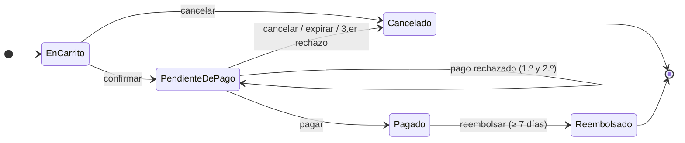

# Diagramas del patrón State

Los diagramas están en [`docs/diagramas/`](diagramas/). Cada uno existe en **SVG** (vectorial: se amplía
sin perder nitidez) y en **PNG** de alta resolución. En GitHub, **haz clic en la imagen** para verla en
grande y usa el zoom del navegador, o abre el archivo `.svg` directamente.

## Estructura general del patrón

| Participante       | Papel                                                                  |
| ------------------ | ---------------------------------------------------------------------- |
| Contexto           | Guarda el estado actual y le delega el trabajo                         |
| Estado             | Interfaz común: una operación por cada acción posible                  |
| Estados concretos  | Implementan su comportamiento y deciden a qué estado pasar             |

## Ejemplo 1 · Solo State: la entrada

Código: [`src/app/state-simple/`](../src/app/state-simple/) · Ruta de la demo: `/patronState/simple`

### Diagrama de clases

### Diagrama de estados

| Estado     | reservar     | pagar    | cancelar                    | entrar              |
| ---------- | ------------ | -------- | --------------------------- | ------------------- |
| Disponible | → Reservada  | rechaza  | rechaza                     | rechaza             |
| Reservada  | rechaza      | → Pagada | → Disponible                | rechaza             |
| Pagada     | rechaza      | rechaza  | rechaza (sin devoluciones)  | → Usada             |
| Usada      | rechaza      | rechaza  | rechaza                     | rechaza (ya se usó) |

## Ejemplo 2 · State + Observer: el pedido

Código: [`src/app/state-observer/`](../src/app/state-observer/) · Ruta de la demo: `/patronState/observer`

### Diagrama de clases

### Diagrama de estados

## Versión Mermaid (editable)

GitHub dibuja Mermaid directamente y permite ampliar y mover el diagrama. Las fuentes de los diagramas de estados son los
archivos `.mmd` de [`diagramas/`](diagramas/).

Ejemplo 1 · clases (Mermaid)

Ejemplo 1 · estados (Mermaid)

Ejemplo 2 · estados (Mermaid)

